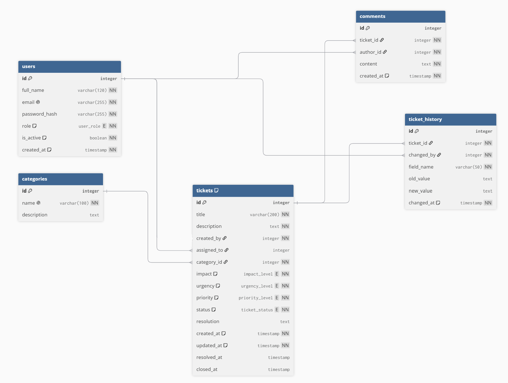

# Podatkovni model

## 1. Opis podatkovne baze

Za FixDesk je predvidena relacijska podatkovna baza PostgreSQL. Podatki so med seboj povezani: zaposleni oddajajo zahtevke, administratorji jih dodeljujejo IT tehnikom, pri zahtevkih pa nastajajo komentarji in zapisi o spremembah.

Vsaka tabela ima primarni ključ (`id`). Povezave med tabelami so predstavljene s tujimi ključi (`FK`).

## 2. Entitete in glavna polja

### 2.1 `users` – uporabniki

Hrani račune vseh uporabnikov aplikacije.

| Polje | Tip | Pomen |
|---|---|---|
| `id` | integer, PK | Enolični identifikator uporabnika |
| `full_name` | varchar(120) | Ime in priimek |
| `email` | varchar(255), UNIQUE | E-poštni naslov za prijavo |
| `password_hash` | varchar(255) | Varno zgoščeno geslo |
| `role` | user_role | `EMPLOYEE`, `TECHNICIAN` ali `ADMIN` |
| `is_active` | boolean | Ali ima uporabnik omogočen dostop |
| `created_at` | timestamp | Datum ustvarjanja računa |

### 2.2 `categories` – kategorije IT težav

| Polje | Tip | Pomen |
|---|---|---|
| `id` | integer, PK | Identifikator kategorije |
| `name` | varchar(100), UNIQUE | Npr. omrežje, programska oprema |
| `description` | text | Opis kategorije |

### 2.3 `tickets` – IT zahtevki

| Polje | Tip | Pomen |
|---|---|---|
| `id` | integer, PK | Številka zahtevka |
| `title` | varchar(200) | Kratek naslov težave |
| `description` | text | Podroben opis težave |
| `created_by` | integer, FK → users.id | Zaposleni, ki je oddal zahtevek |
| `assigned_to` | integer, FK → users.id, NULL | Dodeljeni IT tehnik |
| `category_id` | integer, FK → categories.id | Kategorija težave |
| `impact` | impact_level | Vpliv: `LOW`, `MEDIUM`, `HIGH` |
| `urgency` | urgency_level | Nujnost: `LOW`, `MEDIUM`, `HIGH` |
| `priority` | priority_level | Izračunana prioriteta |
| `status` | ticket_status | Stanje zahtevka |
| `resolution` | text, NULL | Opis izvedene rešitve |
| `created_at` | timestamp | Čas oddaje |
| `updated_at` | timestamp | Čas zadnje spremembe |
| `resolved_at` | timestamp, NULL | Čas rešitve |
| `closed_at` | timestamp, NULL | Čas zaprtja |

Prioriteta je določena na podlagi kombinacije vpliva in nujnosti. Zahtevek se ustvari s stanjem `OPEN`, nato pa potuje skozi `IN_PROGRESS`, `RESOLVED` in `CLOSED`.

### 2.4 `comments` – komentarji

| Polje | Tip | Pomen |
|---|---|---|
| `id` | integer, PK | Identifikator komentarja |
| `ticket_id` | integer, FK → tickets.id | Zahtevek, na katerega se nanaša |
| `author_id` | integer, FK → users.id | Avtor komentarja |
| `content` | text | Vsebina komentarja |
| `created_at` | timestamp | Čas objave |

### 2.5 `ticket_history` – zgodovina sprememb

Ta tabela je namenjena kasnejši funkcionalnosti beleženja sprememb.

| Polje | Tip | Pomen |
|---|---|---|
| `id` | integer, PK | Identifikator spremembe |
| `ticket_id` | integer, FK → tickets.id | Povezani zahtevek |
| `changed_by` | integer, FK → users.id | Uporabnik, ki je izvedel spremembo |
| `field_name` | varchar(50) | Ime spremenjenega polja |
| `old_value` | text, NULL | Prejšnja vrednost |
| `new_value` | text, NULL | Nova vrednost |
| `changed_at` | timestamp | Čas spremembe |

## 3. Povezave med entitetami

- **`users` 1 : N `tickets` (prijavitelj):** en uporabnik lahko odda več zahtevkov; vsak zahtevek ima enega prijavitelja.
- **`users` 1 : N `tickets` (tehnik):** en tehnik ima lahko več dodeljenih zahtevkov; posamezen zahtevek ima največ enega dodeljenega tehnika. Ob oddaji lahko ostane nedodeljen.
- **`categories` 1 : N `tickets`:** vsaka kategorija ima lahko več zahtevkov; vsak zahtevek spada v eno kategorijo.
- **`tickets` 1 : N `comments`:** posamezen zahtevek lahko vsebuje več komentarjev.
- **`users` 1 : N `comments`:** vsak komentar ima enega avtorja.
- **`tickets` 1 : N `ticket_history`:** en zahtevek ima lahko več zabeleženih sprememb.
- **`users` 1 : N `ticket_history`:** vsak zapis spremembe ima izvajalca.

## 4. Osnutek podatkovnega modela - diagram
