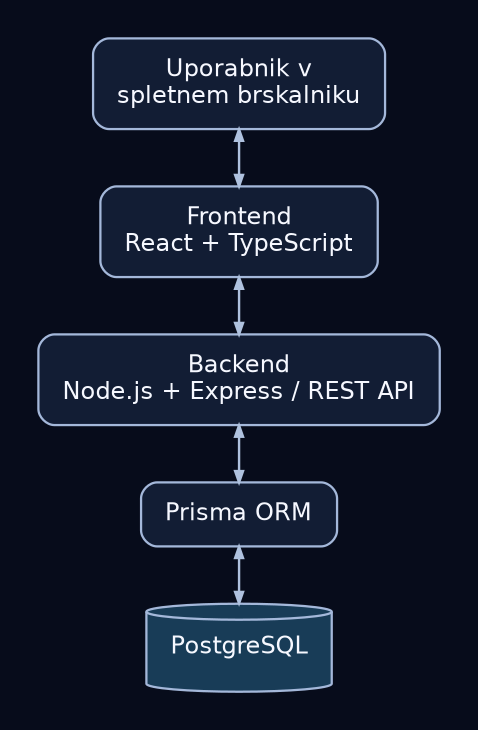

# Arhitektura in tehnološki sklad

## 1. Arhitektura

 Aplikacija bo sestavljena iz uporabniškega vmesnika (frontend), strežniške aplikacije (backend) in relacijske podatkovne baze PostgreSQL. Frontend ne bo neposredno dostopal do podatkovne baze; vsi dostopi in spremembe podatkov bodo potekali prek backenda.

### 1.1 Glavni deli sistema

- **Frontend:** spletni uporabniški vmesnik za zaposlene, IT tehnike in administratorje. Omogoča prijavo, oddajo in pregled zahtevkov, komunikacijo prek komentarjev ter dejanja, dovoljena posamezni vlogi.
- **Backend:** sprejema HTTP zahteve, preverja prijavo in uporabniške pravice ter bere in zapisuje podatke. Tu bodo izvedeni izračun prioritete, dodeljevanje zahtevkov in preverjanje dovoljenih prehodov med stanji.
- **Podatkovna baza:** PostgreSQL hrani uporabnike, kategorije, IT zahtevke in komentarje. Tabela `ticket_history` je predvidena za kasnejšo nadgradnjo.

### 1.2 Komunikacija med deli sistema

1. Uporabnik v brskalniku odpre frontend aplikacije.
2. Frontend prek HTTP pošilja zahtevke na REST API ter prejema odgovore v obliki JSON.
3. Backend preveri identiteto uporabnika in pravice za zahtevano dejanje, nato izvede logiko.
4. Backend uporablja Prisma ORM za dostop do podatkovne baze PostgreSQL.
5. Backend vrne rezultat in ustrezno HTTP statusno kodo; frontend posodobi prikaz.

### 1.3 Diagram arhitekture

### 1.4 Podatkovna baza

Uporabljena bo **PostgreSQL**, saj podatkovni model vsebuje več povezanih entitet in zahteva integriteto podatkov. Osrednja tabela je `tickets`, povezana s tabelami `users`, `categories` in `comments`.

### 1.5 Avtentikacija in avtorizacija

- Uporabnik se prijavi z e-poštnim naslovom in geslom. Backend preveri geslo na podlagi varnega zgoščenega zapisa (bcrypt).
- Ob uspešni prijavi backend izda **JWT**, ki ga odjemalec uporablja pri naslednjih API zahtevah. Za prvo različico je predvidena hramba žetona v piškotku `HttpOnly` z atributom `SameSite=Lax`; v produkciji tudi `Secure` in povezava HTTPS. Zahteve, ki spreminjajo podatke, bodo zaščitene pred CSRF napadi, kjer je to potrebno.
- Backend preverja veljavnost JWT in uporabniško vlogo (`EMPLOYEE`, `TECHNICIAN`, `ADMIN`) za vsako zaščiteno operacijo.
- Zaposleni vidi svoje zahtevke, tehnik dodeljene, administrator pa vse. Dodeliti je mogoče le uporabnika z vlogo tehnika.
- Uporabniške račune in vloge upravlja administrator. Za lokalni razvoj se začetni administratorski račun pripravi z začetnimi podatki, brez javne samostojne registracije.

### 1.6 Lokalni zagon

Predvideno je naslednje razvojno okolje:

- nameščeni Node.js, npm in Docker z Docker Compose
- frontend in backend sta ločena direktorija v istem repozitoriju
- PostgreSQL teče v Docker vsebniku, frontend in backend pa se med razvojem zaženeta lokalno

Predvidena struktura projekta:

```text
fixdesk/
├── frontend/             # React in TypeScript
├── backend/              # Express API in Prisma
│   └── prisma/           # Shema in migracije
├── docs/ 
├── docker-compose.yml
└── README.md
```

## 2. Tehnološki sklad

| Del sistema | Tehnologija oziroma orodje |
|---|---|
| Frontend | React, TypeScript |
| Orodje za frontend | Vite |
| Backend | Node.js, Express, TypeScript |
| Podatkovna baza | PostgreSQL |
| Dostop do baze | Prisma ORM |
| Avtentikacija | JWT, bcrypt |
| Lokalni razvoj | Docker Compose, npm |
| Nadzor različic | Git, GitHub |
| Preizkušanje API | Postman ali Bruno |

## 3. Arhitekturne odločitve

Za razvoj uporabniškega vmesnika sem izbral React in TypeScript, saj sem s tema tehnologijama že delal in imam izkušnje z njuno uporabo. React omogoča razvoj aplikacije s ponovno uporabljivimi komponentami, TypeScript pa s statičnim preverjanjem tipov zmanjšuje možnost napak.

Za razvoj zalednega dela aplikacije sem izbral Node.js z ogrodjem Express, saj sem s tehnologijo Node.js že delal. Express omogoča preprosto izdelavo REST API-ja in povezovanje s podatkovno bazo.

Za podatkovno bazo sem izbral PostgreSQL, ker je FixDesk relacijsko zasnovana aplikacija, v kateri so uporabniki, zahtevki, kategorije in komentarji med seboj povezani. PostgreSQL omogoča učinkovito upravljanje teh povezav in zagotavljanje podatkovne integritete.

Za komunikacijo s podatkovno bazo sem izbral Prisma ORM, ki poenostavi izvajanje poizvedb in upravljanje podatkovnega modela ter omogoča uporabo podatkovnih tipov v TypeScriptu.

Za avtentikacijo sem izbral JWT, saj omogoča preverjanje identitete uporabnikov pri dostopu do zaščitenih API končnih točk. Žeton bo shranjen v piškotku z atributoma HttpOnly in SameSite=Lax, gesla pa bodo varno zgoščena s knjižnico bcrypt.

Za komunikacijo med frontendom in backendom sem izbral REST API, saj omogoča jasno ločitev uporabniškega vmesnika od strežniške logike ter izmenjavo podatkov v formatu JSON.

Za lokalni razvoj sem izbral Docker Compose, ker omogoča enostaven zagon potrebnih storitev in zagotavlja enotno razvojno okolje. Za nadzor različic bom uporabljal Git in GitHub.
