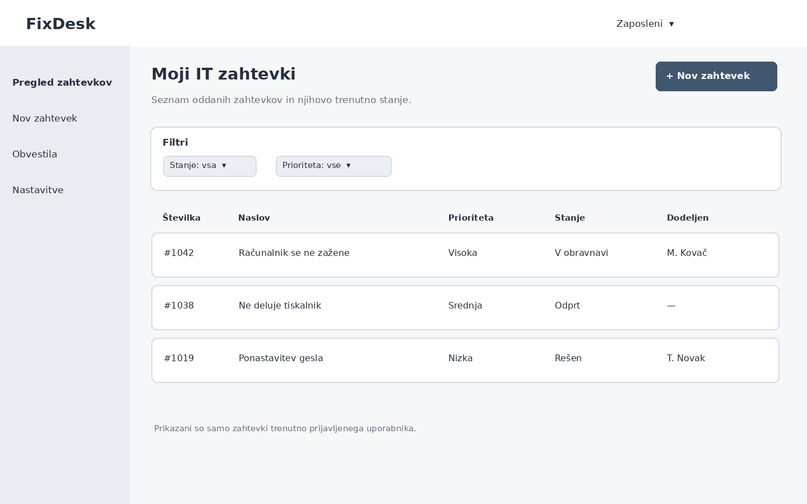
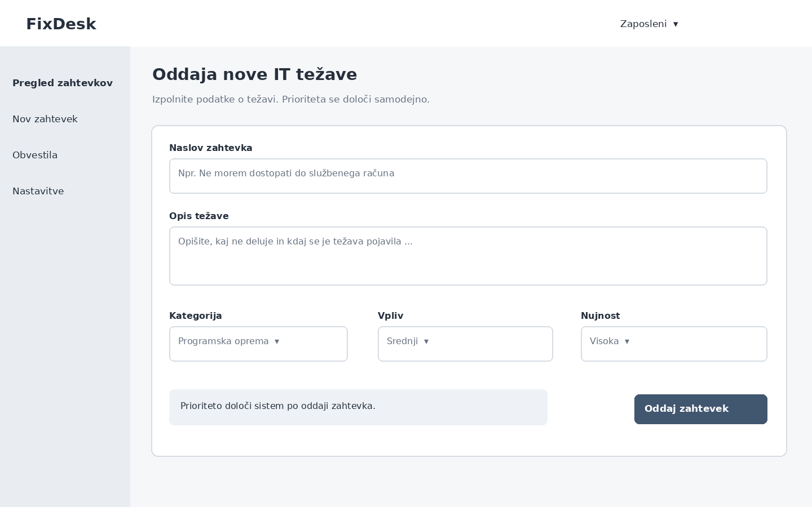
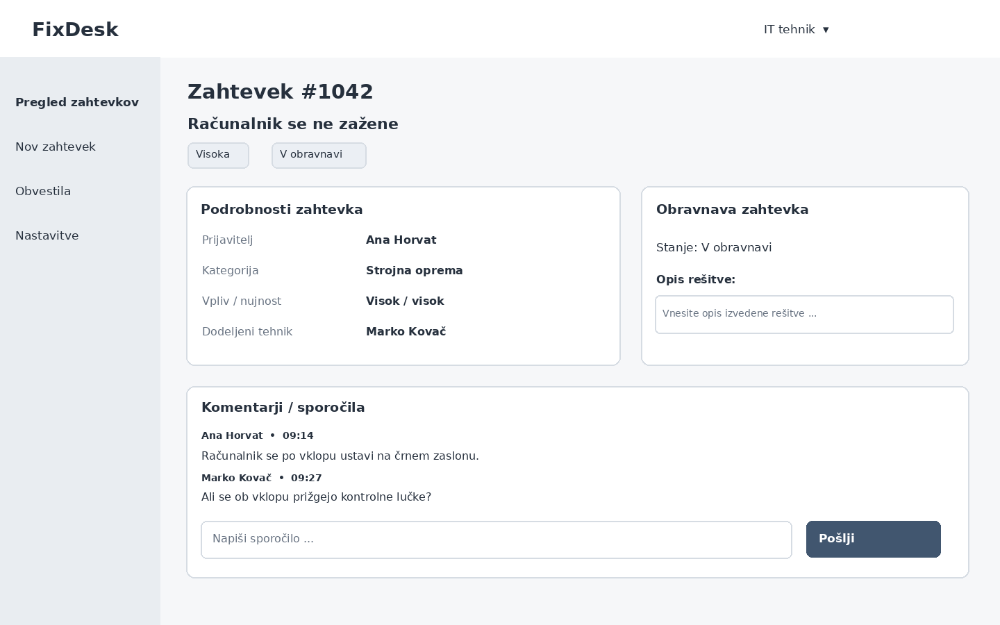
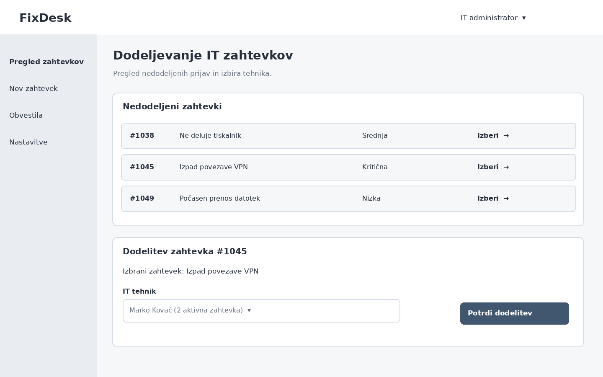

# Wireframes

## 1. Pregled zahtevkov – zaposleni

Na začetnem zaslonu zaposleni vidi seznam svojih IT zahtevkov, njihovo prioriteto, stanje in dodeljenega tehnika. Seznam lahko filtrira po stanju in prioriteti, gumb **Nov zahtevek** pa vodi na obrazec za oddajo. Za tehnika in administratorja je prikaz podoben, vendar se nabor zahtevkov razlikuje glede na pravice.

**Povezane zgodbe:** US-06 (MVP), US-01 (MVP); kasneje tudi US-08.

## 2. Oddaja novega zahtevka – zaposleni

Obrazec vsebuje naslov, opis, kategorijo, vpliv in nujnost. Sistem iz teh podatkov ob oddaji izračuna prioriteto. Obvezna polja morajo biti preverjena, po uspešni oddaji pa uporabnik prejme številko novega zahtevka.

**Povezane zgodbe:** US-01 (MVP), US-02 (MVP), US-07.

## 3. Podrobnosti zahtevka in komunikacija – IT tehnik

Zaslon prikazuje podatke o zahtevku, njegovo stanje, prostor za opis rešitve in kronološko komunikacijo med zaposlenim ter dodeljenim tehnikom. Tehnik lahko pri dovoljenem prehodu označi zahtevek kot rešen; zaposleni na istem zaslonu po rešitvi dobi možnost potrditve in zaprtja zahtevka. Dejanja so odvisna od vloge in stanja zahtevka.

**Povezane zgodbe:** US-04 (MVP), US-05 (MVP), US-06 (MVP); kasneje tudi US-12.

## 4. Dodeljevanje zahtevkov – IT administrator

Administrator vidi nedodeljene zahtevke ter za izbran zahtevek določi odgovornega IT tehnika. Izbirnik tehnikov vsebuje samo aktivne tehnike. Prikaz trenutnega števila aktivnih zahtevkov ob posameznem tehniku je predviden za kasnejšo funkcionalnost pregleda obremenjenosti.

**Povezane zgodbe:** US-03 (MVP), kasneje US-10.
